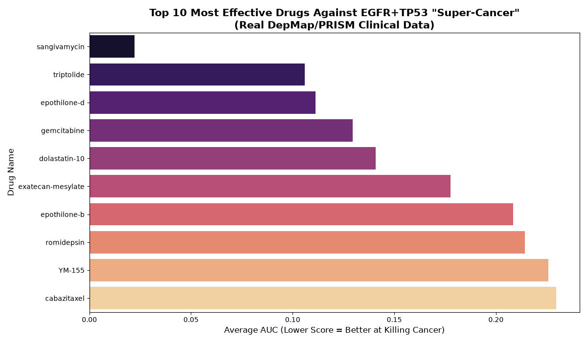

# Phase 1: Machine Learning Prediction of Erlotinib Resistance Biomarkers in NSCLC

**Objective:** To train a Random Forest regression model on clinical pharmacogenomic data to identify the primary genomic mutations predictive of resistance to Erlotinib (an EGFR-targeted therapy) in Non-Small Cell Lung Cancer (NSCLC).

## The Clinical Context
Cancer drug resistance is a primary failure point in clinical oncology. This initial phase was designed to test whether machine learning could accurately identify known drivers of drug resistance purely from raw genomic and pharmacological screening data, without being pre-programmed with biological rules. 

## Methodology & Data Integration
To build the custom training set, I had two independent clinical databases that were integrated using Python:
1. **Genomics of Drug Sensitivity in Cancer (GDSC2):** Sourced from the Wellcome Sanger Institute, this provided the continuous IC50 values (drug concentration required for 50% growth inhibition), serving as the quantitative measure of Erlotinib resistance for each NSCLC cell line.
2. **COSMIC Cell Line Project:** Provided the matched binary somatic mutation matrices for the corresponding cell lines.

The Python script (`analysis.py`) merges these datasets into a unified matrix (`master_research_data.csv`) and trains a **Random Forest Regressor** to predict IC50 values based on mutational profiles. The model's feature importance weights were then extracted to identify the genes most highly predictive of altered drug response.

## Key Findings

Without requiring any hard-coded biological priors, the Random Forest model successfully identified clinically validated biomarkers of Erlotinib response:

* **Primary Feature (`EGFR`):** The model identified the *EGFR* gene as the highest-weighted predictive feature. This perfectly aligns with clinical reality, as Erlotinib is specifically designed to target mutant *EGFR* kinase domains.
* **Secondary Resistance Features (`TP53` & `STK11`):** The model successfully identified mutations in key tumor-suppressor genes, notably *TP53* and *STK11*, as major secondary variables predictive of drug response variance. 

## Transition to Phase 2: The "Double-Mutant" Problem
Phase 1 successfully highlighted the viability of the ML pipeline and highlighted a severe clinical obstacle: cancers harboring concurrent mutations in both *EGFR* (the oncogenic driver) and *TP53* (the disabled tumor suppressor) represent a highly aggressive, treatment-refractory profile. 

Because standard targeted therapies like Erlotinib struggle against this specific mutational combination, **Phase 2** of this project shifts to the Broad Institute's PRISM Repurposing dataset to conduct a massive computational drug screen, seeking a novel compound capable of eradicating the *EGFR/TP53* double-mutant "super-cancer."

## PHASE 2: OVERCOMING DOUBLE-MUTATION DRUG RESISTANCE

**The Clinical Problem:**
While the AI correctly identified that EGFR mutations drive resistance to targeted therapies, the clinical reality is often more complicated. Some aggressive lung cancers present a "double mutation" where both the gas pedal (EGFR) is permanently engaged at the same time that the brakes (TP53) have been physically removed, making targeted treatments ineffective against "super cancer" cells that can ignore apoptosis signals.

**The Bioinformatics Solution:**
In order to find potential backup therapies, I created a Python data pipeline to find relevant hits in gigabytes of real-world clinical screening data from the Broad Institute's Cancer Dependency Map (DepMap) and PRISM repurposing datasets.

The pipeline:
1. Cross-referenced Hotspot and Damaging mutation matrices to mathematically find lung cancer cell lines that contain both an EGFR Hotspot mutation and a non-functional TP53 gene.
2. Standardized ID mismatches (PR- vs ACH-) between databases using an `OmicsProfiles` mapping dictionary.
3. Used Pandas groupby() and aggregation functions to calculate average AUC scores for thousands of clinical compounds screened against these 3 highly specific double-mutant cancer models, isolating the lowest average AUC scores (most cytotoxic compounds).

**The Results:**

The clinical screening data perfectly validated the biological hypothesis—targeted therapies were not among the top drugs for treating this form of refractory lung cancer.

Instead, the results demonstrate that heavily cytotoxic compounds are required to kill these double-mutant cancer cells by physically preventing cell division, DNA replication, or forcing apoptosis:

| Cell Skeleton Freezers (Microtubule Inhibitors) | DNA Shredders (Topoisomerase/DNA Synthesis Inhibitors) | p53-Bypass Compounds (Apoptosis Forcers) |
| :--- | :--- | :--- |
| Cabazitaxel | Gemcitabine | YM-155 |
| Epothilone-B/D | Exatecan-Mesylate | Romidepsin |
| | | Sangivamycin |

Note: To run this file locally, you'll need to download the raw Broad Institute DepMap Public 20Q2 and PRISM Repurposing 20Q2 Secondary Screen .csv datasets into the project directory. They are too large to be uploaded to GitHub and are excluded by the .gitignore file.

# Phase 3: Baseline Transcriptomic Signatures Associated with Sangivamycin Tolerance in NSCLC

**Objective:** To identify baseline transcriptomic expression programs associated with continuous Sangivamycin drug tolerance across Non-Small Cell Lung Cancer (NSCLC) models.

## Challenges & Methodological Adaptations

Computational oncology workflows must adapt when constrained by cohort architecture and lineage structure:

### Challenge 1: The Sample Size Limit ($N=3$)
* **The Problem:** The initial hypothesis targeted resistance signatures specifically within the *EGFR/TP53* double-mutant subset. However, cross-referencing DepMap's Hotspot and Damaging mutation matrices against PRISM screening data identified only 3 verified double-mutant models with matched RNA-seq profiles.
* **The Adaptation:** With only three eligible double-mutant models, a simple gene-expression-versus-AUC regression would possess just one residual degree of freedom ($df = 3 - 2 = 1$), making genome-wide inference highly unreliable. The analysis was broadened to 61 matched NSCLC models, and conclusions are explicitly limited to the pan-NSCLC cohort rather than the double-mutant subgroup. All 19,219 genes were evaluated against continuous Sangivamycin AUC.

### Challenge 2: Potential Lineage Confounding
* **The Problem:** Initial continuous-AUC regression revealed positive enrichment for "Epidermis Development" and "Cell-Cell Adhesion." Because NSCLC encompasses distinct histological lineages (including Squamous Cell Carcinoma and Adenocarcinoma) and epidermal markers such as keratins are characteristic of squamous differentiation, the raw association risked capturing baseline lineage expression rather than drug-response variation.
* **The Adaptation:** To evaluate whether expression associations persist when conditioning on histological categories, a vectorized multivariate Ordinary Least Squares (OLS) regression was fitted for each gene:

  $$\text{Expression}_g = \beta_{0,g} + \beta_{1,g}\text{AUC} + \gamma_g\text{Histology} + \epsilon_g$$

  Histology was dummy-encoded across verified categories (36 Adenocarcinoma, 15 Squamous Cell Carcinoma, and 10 Other NSCLC models). The partial t-statistic for the AUC coefficient ($\beta_{1,g}$, $df=57$) was utilized to rank all 19,219 genes for downstream pathway analysis.

---

## Methodology & Statistical Controls

The final pipeline utilized a 61 (cell lines) $\times$ 19,219 (genes) expression matrix, addressed profile-level replication, and adjusted for recorded broad histological categories:
1. **Replicate Aggregation:** RNA expression profiles were mapped to DepMap model IDs using `OmicsProfiles.csv`. Where metadata supported treating multiple profiles as technical replicates, their $\log_2(\text{TPM} + 1)$ values were averaged to produce one model-level expression profile on the log-transformed scale.
2. **Directionality of Response:** Higher Sangivamycin AUC values indicate greater cell viability across doses, corresponding to reduced drug sensitivity and greater tolerance. Positive regression t-statistics therefore reflect genes whose baseline expression increases with AUC, conditional on the modeled histology categories.
3. **Multivariate Ranking Metric:** Genes were ranked by the partial t-statistic of the AUC coefficient ($\beta_{1,g}$) from the multivariate OLS model ($df=57$), estimating expression associations conditional on broad histology.
4. **Preranked GSEA Configuration:** Ranked Gene Set Enrichment Analysis was performed using `gseapy.prerank` against `GO_Biological_Process_2021`, with gene-set permutations ($N=1000$, `seed=42`, `min_size=15`, `max_size=500`). The gene-set size thresholds restricted testing to sets containing 15–500 genes represented in the ranked dataset, reducing the influence of very small gene sets and excluding overly broad sets.

## Key Findings

Preranked GSEA performed on the gene ranking derived from the histology-adjusted regression identified one statistically robust pathway and one attenuated exploratory pathway:

### 1. Calcium-Dependent Cell-Cell Adhesion
* **Identifier:** GO:0016339 | NES = 2.24 | Pathway FDR q = 0.003
* **Leading-Edge Drivers:** `DSG1`, `CDH9`, `CDH19`, `CDH8`, `CDH13`, `CDH10`, `CDH24`, `CDH17`.
* **Interpretation:** This pathway remained significantly enriched after adjustment for broad histological categories, supporting an association between baseline cell-adhesion expression and Sangivamycin AUC conditional on the modeled covariates. Notably, the leading edge is enriched for desmosomal assembly (`DSG1`) and Type II atypical cadherins rather than classical E-cadherin (`CDH1`). This association does not establish that the relationship is identical across NSCLC subtypes or exclude residual confounding.

### 2. Epidermis Development
* **Identifier:** GO:0008544 | NES = 2.07 | Pathway FDR q = 0.094 (Exploratory)
* **Leading-Edge Drivers:** `LCE2B`, `KRT14`, `SPRR2G`, `SPRR2B`, `SPRR2E`, `SPINK5`, `KRT9`, `SPRR1A`.
* **Interpretation:** The weaker enrichment after histology adjustment is consistent with the possibility that part of the original association reflected histology-associated expression differences. The analysis does not establish that squamous lineage alone explains the attenuation.

## Limitations & Technical Qualifications

1. **Additive Model Constraints:** The multivariate model assumes an additive relationship between AUC and histology categories. It does not evaluate interaction terms ($\text{AUC} \times \text{Histology}$), which would require a larger sample size than $N=61$ to test reliably.
2. **Histological Heterogeneity:** Combining 10 models into an "Other NSCLC" category controls for differences from the adenocarcinoma and squamous groups, but retains residual within-group heterogeneity, including differences among less common NSCLC classifications such as large-cell carcinomas.
3. **Tied Ranking Statistics:** Approximately 1.12% of genes exhibited tied ranking statistics clustered at $t = 0.0$. These ties arise from unexpressed or invariant genes across the cell lines. Because preranked GSEA may order tied genes arbitrarily, the tied fraction is documented as a limitation of the ranking procedure, although these median ties do not impact leading-edge genes located at the distribution tails.
4. **Permutation Resolution:** For standard permutation-based GSEA, 1,000 permutations yield a minimum nominal p-value resolution of approximately 0.001. This limits the numerical resolution of nominal enrichment probabilities and should be distinguished from pathway-level FDR q-values.
5. **Scope of Inference:** The analysis identifies baseline transcriptomic associations across a pan-NSCLC cohort. Because only three eligible *EGFR/TP53* double-mutant models were available, the findings cannot be assumed to apply specifically to that double-mutant subgroup. The observational analysis also cannot establish that the identified expression programs cause Sangivamycin resistance.

## Final Conclusion

The continuous-AUC analysis identified a baseline transcriptomic association between calcium-dependent cell-cell adhesion gene sets and Sangivamycin response in NSCLC cell lines. This pathway remained significantly enriched after adjustment for broad histological classification (NES = 2.24, pathway FDR q = 0.003), with leading-edge drivers including multiple cadherins and the desmosomal gene DSG1. The epidermis-development pathway showed weaker enrichment after adjustment (NES = 2.07, pathway FDR q = 0.094), suggesting that its initial association may be partly attributable to histological differences.

These findings identify candidate baseline expression signatures associated with Sangivamycin AUC. They do not establish causation or demonstrate a specific cellular resistance mechanism. Further validation in independent datasets and, where feasible, experimental systems is needed to determine their reproducibility and biological significance such as a hands on wet lab.
